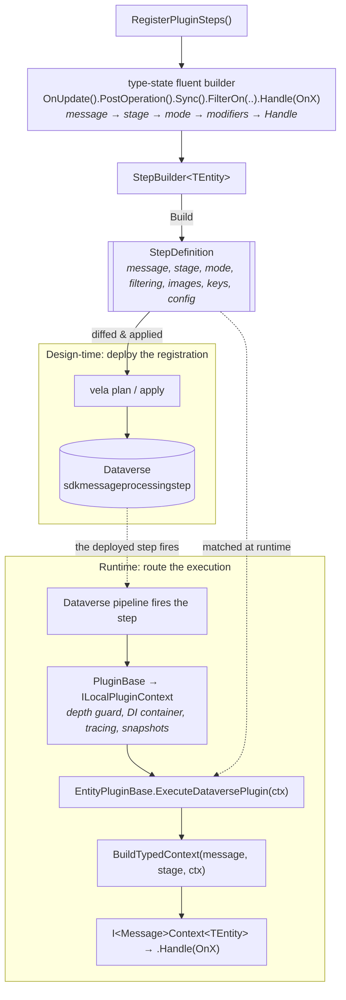

# Architecture

This page describes how the Vela repository is laid out, the rules that keep its projects apart, and how a plugin
flows from its registration code to Dataverse and back at runtime. It is for people who build or contribute to the
framework. To use Vela, start with the [CLI overview](../guides/cli-overview.md).

## Solution layout

```text
Vela.sln
src/
  Vela.Plugins/    # Framework runtime: base classes, step builder, contexts, services (bundles the analyzers and code fixes)
  Vela.Messages/   # SDK-only typed request/response types, shared by plugins and net10.0 callers
  Vela.Cli/        # The `vela` CLI: scaffolding, models, plan/apply/inspect, signing
  Vela.Testing/    # In-memory Dataverse and `PluginPipeline` for tests
  Vela.Analyzers/  # Roslyn analyzers and the source generator (shipped inside Vela.Plugins)
  Vela.CodeFixes/  # Roslyn code fixes (shipped inside Vela.Plugins)
tools/
  codegen/Vela.StepApiGen/  # Generates Steps/StepApi.cs, StepBuilder.Impl.cs and TypedTriggers.cs from MessageModel.cs
docs/
  samples/Vela.DocSamples/  # Compiled, tested snippets included by the docs site
tests/
  Vela.Tests/            # Runtime/framework unit tests
  Vela.Testing.Tests/    # In-memory harness/pipeline tests
  Vela.Cli.Tests/        # CLI unit tests
  Vela.Analyzers.Tests/  # Analyzer and source-generator tests
  Vela.CodeFixes.Tests/  # Code-fix tests
  ContractPluginFixture/ # A real Vela.Plugins plugin that the CLI and the framework tests both check
  contracts/             # against plugin-contract.golden.json
  SamplePluginFixture/, BrokenPluginFixture/  # Packages the CLI tests scan
  stryker/               # Mutation-testing configuration, one file per area
.github/workflows/     # ci.yml, mutation.yml, docs.yml, changelog.yml, release.yml
```

## Architecture rules

Follow these rules when you add code:

1. **`Vela.Plugins` is the runtime.** It holds framework code, contracts, primitives and immutable definitions, and
   runs in the Dataverse sandbox.
2. **`Vela.Cli` is the tooling.** It is the one CLI used locally and in CI.
3. **Early-bound models belong to the consumer.** Generated model code lives in the plugin repository, not in this
   one.
4. **No sample application code in the shipped packages.** Samples and fixtures live under `docs/samples` and
   `tests`.
5. **Registration metadata and runtime execution stay separate.** They meet only through `StepDefinition` (below).

## How a plugin is built

A Vela plugin is a normal Dataverse `IPlugin`, but you do not implement `IPlugin` or touch the raw
`IServiceProvider`. You inherit `EntityPluginBase<TEntity>` and describe what the plugin does; the framework owns the
plumbing. Two concerns stay separate, and they meet only through one immutable value, the `StepDefinition`:

- **Registration metadata:** when the plugin fires (message, stage, mode, filtering attributes, images,
  configuration). It is declared in `RegisterPluginSteps()`, built into `StepDefinition`s, and reconciled into
  Dataverse by `vela plan` and `vela apply`. This never runs your business logic.
- **Runtime execution:** what happens when it fires. Dataverse instantiates your class and calls it, and the base
  class routes the call to the right typed handler.

You build each `StepDefinition` once from the fluent chain, and it is used in two independent ways: deployed into
Dataverse, and matched at runtime to route the call to your handler.



### The layers, from the entry point down

1. **`PluginBase` (the entry point).** Implements `IPlugin.Execute(IServiceProvider)`. It builds the
   `ILocalPluginContext`: the depth guard, the per-execution dependency injection container, the organization
   services wrapped with automatic tracing of Dataverse operations, and the start and failure execution snapshots
   (metadata only unless `AutoSnapshotDetail` is `Full`). It then calls the single abstract method
   `ExecuteDataversePlugin(ILocalPluginContext)`. Everything below sees only the typed context, never the raw
   `IServiceProvider`.
2. **`EntityPluginBase<TEntity>` (the router).** Ties the plugin to one early-bound entity. On first use it runs
   `RegisterPluginSteps()` once, collects the `StepDefinition`s, and caches them (thread-safe, because the sandbox
   reuses one instance concurrently). At runtime it matches the current execution (message, stage, mode and entity)
   to its steps. When several steps share that trigger, the executing step (`OwningExtension`, the step's
   name or, for an async step, its id) selects one by step key (`StepIdentity.Select`), then the base invokes that
   step's typed handler. Ambiguous or missing handlers fail fast with a clear message.
3. **`StepBuilder<TEntity>` (the type-state builder).** `RegisterStep()` returns a fluent chain whose *type* at
   each position only exposes the calls that are legal next: message → stage → mode, then order-free modifiers
   (`FilterOn`, images, `WithStepKey`, ...) and `Handle(...)` last. The message and stage you pick offer only the
   images that combination supports, and the [analyzers](../reference/analyzers.md) catch what the types cannot (a
   missing `FilterOn` on Create or Update is VELA020, an image the message refuses is VELA007), so a bad
   registration fails the build. `Build()` produces the immutable `StepDefinition` and checks the invariants again,
   as a backstop for reflection or out-of-order assembly.
4. **Typed message contexts (the foundation).** For a modelled message the router wraps the runtime context in an
   `I<Message>Context<TEntity>` (for example `IUpdatePostContext<Account>`). That context is a thin, allocation-cheap
   view: `ctx.Response` is the **standard SDK response class** (`CreateResponse`, `UpdateResponse`, ...) and
   `ctx.Request` is a **Vela-owned typed request** for `Create` / `Update` / `SendEmailFromTemplate`
   (`Vela.Messages.CreateRequest<TEntity>` / `UpdateRequest<TEntity>` / `SendEmailFromTemplateRequest<TEntity>`) or the
   standard SDK request for every other message, each projected over the pipeline's `InputParameters` /
   `OutputParameters` collections. Every message reads its primary record from the typed `ctx.Request.Target` or
   `ctx.Request.Targets`: an early-bound `TEntity` on `Create` and `Update`, the SDK's `Entity`, `EntityReference`
   or `EntityCollection` otherwise. The handler is bound by method group, so the handler's context type is checked
   against the message at build time: an `OnUpdate()` step bound to an `ICreatePostContext<T>` handler is a VELA015
   error. A non-modelled `On<TRequest>()` step
   receives the request-typed `IMessagePre/PostContext<TRequest>`, and an `OnMessage<TMarker>()` step the plain
   `ILocalPluginContext`.

### Why this shape

- **One source for deployment and dispatch.** Because registration metadata (`StepDefinition`) is separate from
  execution, the same code drives the deployment (`plan` and `apply` compare the definitions with the environment)
  and the runtime dispatch. There is no second "where does this fire" configuration to keep in sync.
- **Mistakes fail the build, not the deployment.** Image and stage validity live in the types, so a whole class of
  registration mistakes becomes a compile error.
- **The typed context is a view, not a copy.** It projects over the pipeline's own parameter collections (SDK
  responses, and thin typed requests over the live `InputParameters`) rather than over separate DTOs, so it cannot
  drift from the real pipeline data.
